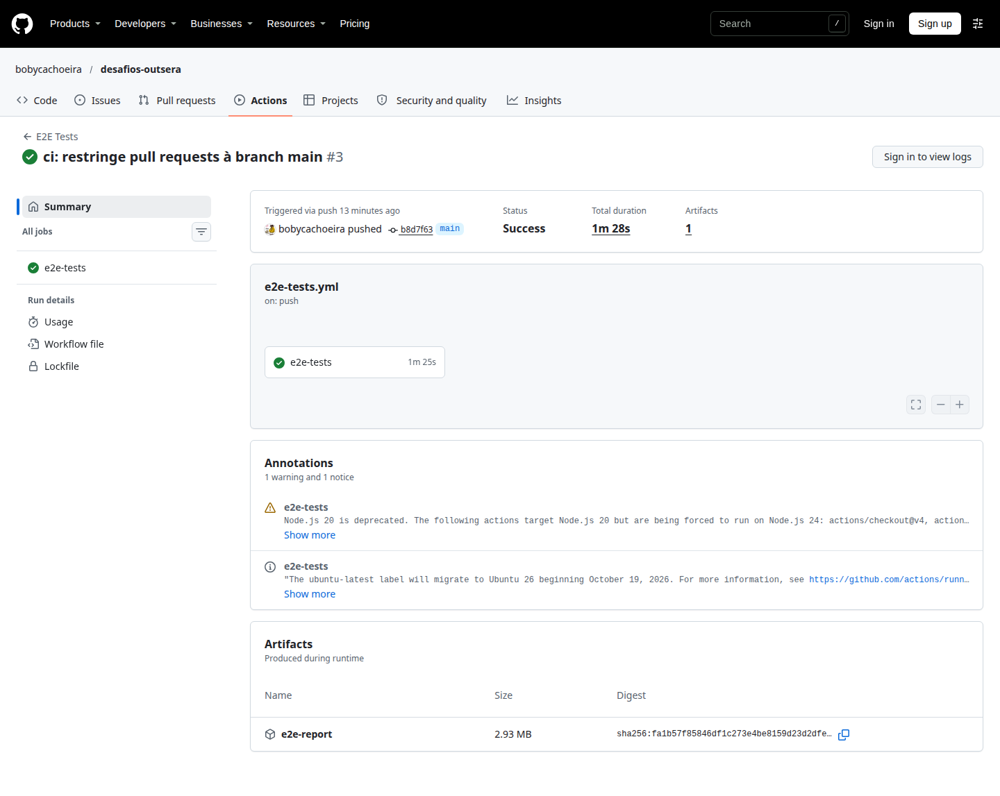
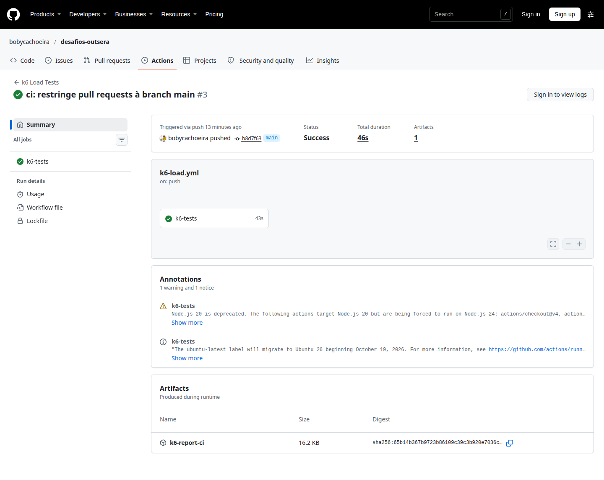
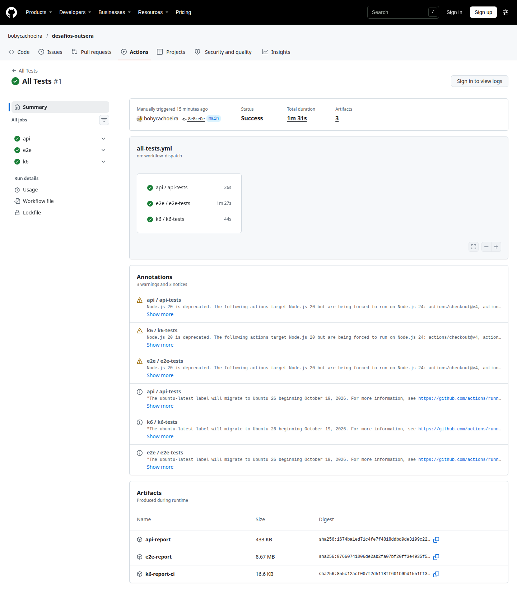

# Desafio 3 — Integração e CI/CD

Pipeline no GitHub Actions para executar os testes dos desafios 1, 2 e 4 no mesmo repositório.

## Estrutura

Os workflows ficam na raiz do repositório, pois o GitHub Actions só lê `.github/workflows/`:

```text
.github/workflows/
├── api-tests.yml   # desafio-1-api (Jest + Supertest)
├── e2e-tests.yml   # desafio-2-e2e (Playwright + Cucumber)
├── k6-load.yml     # desafio-4-k6 (k6)
└── all-tests.yml   # execução manual dos três
```

Cada workflow usa `working-directory` para apontar para a pasta do projeto correspondente.

## Gatilhos

- `push` na `main`: executa apenas os workflows cujos arquivos do projeto mudaram (`paths`).
- `pull_request` para a `main`: mesmo comportamento, validando a alteração antes do merge.
- `workflow_dispatch`: execução manual de um workflow específico.
- `all-tests.yml`: execução manual que chama API, E2E e k6 de uma vez.

O filtro `paths` evita rodar a suíte inteira em commits que não afetam o projeto. Uma alteração em
`desafio-1-api/` roda só a API; uma alteração em `desafio-2-e2e/` roda só o E2E.

## API Tests

Arquivo: `.github/workflows/api-tests.yml`

- Dispara com mudanças em `desafio-1-api/**` ou no próprio workflow.
- Instala Node.js 20 e executa `npm ci`.
- Copia `.env.example` para `.env`.
- Executa Jest + Supertest contra o ServeRest.
- Publica o relatório como artifact `api-report`.

Execução validada:


## E2E Tests

Arquivo: `.github/workflows/e2e-tests.yml`

- Dispara com mudanças em `desafio-2-e2e/**` ou no próprio workflow.
- Instala Node.js 20, dependências e Chromium do Playwright.
- Executa o Cucumber contra o Automation Exercise.
- Publica `e2e-report` com relatório HTML/JSON e screenshots dos cenários.

Execução validada:



## k6 Load Tests

Arquivo: `.github/workflows/k6-load.yml`

- Dispara com mudanças em `desafio-4-k6/**` ou no próprio workflow.
- Executa `./scripts/check.sh` antes da carga.
- No automático usa o perfil `ci`: **15 VUs por 30 segundos**.
- No disparo manual é possível escolher `smoke`, `ci`, `load` ou `challenge`.
- Publica `k6-report-<perfil>` com `console.log`, `metadata.txt`, `summary.json` e `summary.html`.

O k6 no CI roda **sem `--influx`**. O Grafana/InfluxDB é uma stack local via Docker Compose e não
existe no runner do GitHub. No CI, a evidência são os arquivos publicados como artifact.

Execução validada:



## All Tests (manual)

Arquivo: `.github/workflows/all-tests.yml`

- Só executa via `workflow_dispatch`.
- Chama os três workflows reutilizáveis (`workflow_call`).
- Roda API, E2E e k6 em paralelo, cada um com seu artifact.

Execução validada:



## Evidências no GitHub

| Workflow | Resultado |
|---|---|
| [API Tests](https://github.com/bobycachoeira/desafios-outsera/actions/runs/40906107004) | success |
| [E2E Tests](https://github.com/bobycachoeira/desafios-outsera/actions/runs/40906107322) | success |
| [k6 Load Tests](https://github.com/bobycachoeira/desafios-outsera/actions/runs/40906106982) | success |
| [All Tests](https://github.com/bobycachoeira/desafios-outsera/actions/runs/40905731286) | success |

## Como executar

```bash
# Manualmente, um workflow por vez
gh workflow run "API Tests" --ref main
gh workflow run "E2E Tests" --ref main
gh workflow run "k6 Load Tests" --ref main -f profile=ci

# Manualmente, os três de uma vez
gh workflow run "All Tests" --ref main

# Acompanhar
gh run list
gh run watch
```

## Pré-requisitos

- `package-lock.json` nos projetos 1 e 2 para o `npm ci`.
- Testes implementados nos desafios 1 e 2.
- Acesso aos sites públicos usados nos testes (ServeRest e Automation Exercise).
- Nenhum segredo ou `.env` versionado.
